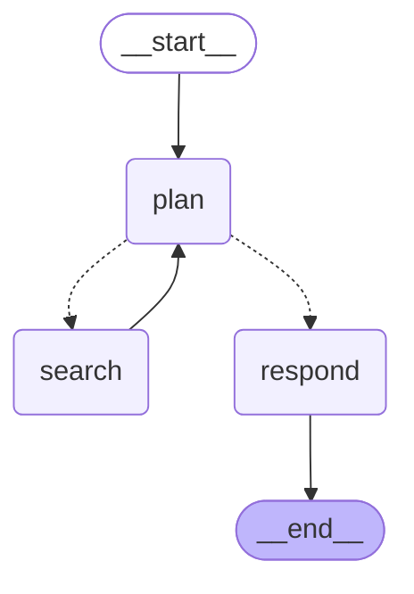
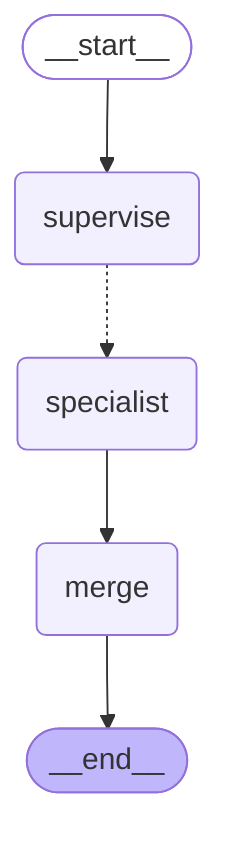

# portugal-services-qa

Question answering over official Portuguese public-service pages (AIMA, Finanças, Segurança Social
and SNS). Questions can be asked in Turkish, English or Portuguese. Answers come back in the same
language, cite the page they came from, and say so when the pages do not cover the question.

The repo compares three ways of answering the same questions:

- **RAG**: retrieve the top 5 chunks, answer once.
- **Agent**: a LangGraph loop where the model decides which agency to search, reads the results
  and searches again, up to 4 times.
- **Multi-agent**: a supervisor splits the question by agency, one specialist per agency searches
  and answers its part in parallel, and a merge step writes the final answer.

## Examples

These are RAG answers from the evaluation run, copied as they came out.

> **İşsizlik ödeneği almak için ne kadar süre çalışmış olmam gerekiyor?**
>
> İşsizlik ödeneği almak için son 24 ay içinde, işsizlik tarihinden önceki dönemde en az 360 gün
> ücretli işte çalışmış olmanız gerekir [1].
>
> [1] https://www.gov.pt/servicos/requerer-o-subsidio-de-desemprego

> **When do I have to file my IRS return for the income I earned last year?**
>
> You must file your IRS return between 1 April and 30 June of the year following the year in which
> you earned the income [2]. You can submit the declaration online via the Portal das Finanças [1].
>
> https://www.gov.pt/servicos/simular-e-entregar-a-declaracao-anual-do-irs

> **Onde peço o subsídio de desemprego e onde tenho de me inscrever antes?**
>
> O pedido do subsídio de desemprego deve ser feito presencialmente nos balcões de atendimento da
> Segurança Social [1]. Antes de pedir o subsídio, deve inscrever-se no centro de emprego mais
> próximo da sua área de residência [1].
>
> [1] https://www.gov.pt/servicos/requerer-o-subsidio-de-desemprego

## How it works

### Data

`sources.txt` lists 18 pages with the agencies each one covers. Three more pages from the
Segurança Social portal are stored as text in `data/manual/`, because that portal renders
everything client side. That makes 21 pages and about 17,000 words, in `data/pages.jsonl`.

The extraction is written per site, because trafilatura drops most of the useful content:

- aima.gov.pt keeps documents, fees and legal basis inside collapsed accordion items.
- www.gov.pt is a Next.js site that fills its how-to tabs from the embedded `__NEXT_DATA__` JSON,
  so the text is read from there.

### Index and retrieval

Pages are split on their section headings, then into chunks of 1,500 characters with 1/8 overlap
(LangChain `RecursiveCharacterTextSplitter`). Each chunk starts with `page title / section` and
carries one boolean per agency, so searches can be filtered by agency. Chunks are embedded with
BAAI/bge-m3 into a local Chroma store (160 chunks).

`store.Retriever` has five modes:

| Mode | What it does |
|---|---|
| `dense` | bge-m3 cosine similarity |
| `bm25` | keyword search (rank-bm25) on accent-folded tokens |
| `hybrid` | dense and BM25 top 20 fused with reciprocal rank fusion (k = 60) |
| `dense+rerank` | dense top 20 re-scored by the BAAI/bge-reranker-v2-m3 cross-encoder |
| `hybrid+rerank` | hybrid top 20 re-scored by the cross-encoder (default) |

### Answering

The answer step is one LCEL chain (`prompt | ChatOpenAI | StrOutputParser`) used by all three
modes, so they differ only in how they collect sources. Sources are numbered, the model cites
them as `[n]`, and the code maps numbers back to URLs. The prompt asks for European Portuguese and
a fixed "not found" sentence per language, and ends with an explicit `Answer in <language>` line,
since without it the model drifted to Portuguese on English questions.

Any OpenAI-compatible endpoint works. The results below use Qwen/Qwen3.5-4B served by vLLM with
thinking turned off.

### Agent

Three tools, `search_aima`, `search_tax` and `search_social`, each search one agency (3 chunks).
Hits are numbered across searches, and repeated chunks are reported as already listed. The
planner stops by replying without tool calls, or when it reaches 4 searches.



### Multi-agent

The supervisor returns a JSON plan (structured output): which agencies the question needs and one
Portuguese search query for each. LangGraph `Send` starts one specialist per agency in parallel.
Each specialist searches its agency with both the query and the original question, fuses the two
result lists with RRF, keeps 4 chunks and answers only its part. The merge step renumbers the
citations into one list and combines the parts. It skips the extra LLM call when only one part
has an answer, and returns the "not found" sentence when none does.



Both diagrams come from the code: `ptqa graph` and `ptqa graph --multi`.

## Evaluation

`questions.jsonl` has 47 questions:

- 26 single-page questions, split evenly across Turkish, English and Portuguese
- 16 multi-page questions that need two or three pages, most of them from different agencies
- 5 questions the pages do not answer (nationality, driving licence, child benefit, golden visa,
  school enrolment)

Each question lists the pages that count as a correct source. The questions are written in
everyday language, and `near_copy` flags any question that shares wording with its own source
page, since that would make retrieval look better than it is. None are flagged.

Metrics:

- **Hit@k, MRR**: whether a correct page is among the first k distinct pages retrieved, and how
  high it ranks.
- **Cites a right page**: the answer cites at least one correct page.
- **Wrong "not found"**: the model gives up on a question the pages do answer.
- **Page coverage, all pages found, cites all needed pages**: for multi-page questions.
- **"Not found" with and without sources**: on unanswerable questions, with retrieval and
  closed-book (the same model with no sources).
- **Cost**: searches, LLM calls and seconds per question.

## Results

All numbers below come from `results/`, with Qwen3.5-4B as the answer model and
`hybrid+rerank` retrieval unless noted.

### Retrieval

42 answerable questions, no LLM involved (`ptqa retrieval`). Hit@k and MRR are over the 26
single-page questions; coverage is over the 16 multi-page questions, with 5 chunks each.

| Retrieval | Hit@1 | Hit@3 | Hit@5 | MRR | Hit@1 tr / en / pt | Multi-page coverage | ms per query (GPU) |
|---|---|---|---|---|---|---|---|
| dense | 73% | 88% | 100% | 0.83 | 100 / 67 / 56 | 51% | 12 |
| bm25 | 35% | 50% | 50% | 0.42 | 38 / 22 / 44 | 34% | 0 |
| hybrid | 54% | 85% | 88% | 0.69 | 50 / 56 / 56 | 50% | 9 |
| dense+rerank | 85% | 100% | 100% | 0.92 | 88 / 89 / 78 | 57% | 367 |
| hybrid+rerank | 85% | 100% | 100% | 0.92 | 88 / 89 / 78 | 59% | 349 |

The pages are in Portuguese and two thirds of the questions are not, so BM25 alone is weak, and
fusing it with dense retrieval at equal weight makes the ranking worse. The cross-encoder is what
helps: it lifts Hit@1 from 73% to 85%. Whether its candidates come from dense or hybrid retrieval
makes almost no difference (one more page found on the multi-page questions), so the BM25 part is
within noise here.

### RAG, agent and multi-agent

| Mode | Single-page Hit@5 | Multi-page coverage | All pages found | Cites all needed pages | "Not found" on unanswerable | Searches | LLM calls | Seconds |
|---|---|---|---|---|---|---|---|---|
| RAG | 100% | 59% | 25% | 19% | 100% | 1.0 | 1.0 | 2.7 |
| Agent | 100% | 95% | 88% | 62% | 100% | 3.8 | 5.1 | 6.4 |
| Multi-agent | 96% | 86% | 69% | 12% | 100% | 2.9 | 2.7 | 4.5 |

Multi-page questions by the number of agencies involved (all pages found / cites all needed
pages):

| Mode | Two agencies (11) | Three agencies (4) |
|---|---|---|
| RAG | 27% / 27% | 0% / 0% |
| Agent | 91% / 73% | 75% / 50% |
| Multi-agent | 73% / 18% | 50% / 0% |

On single-page questions the three modes are close, and the agents only add calls and time. The
agent pays off when a question spans agencies: one search cannot pull pages from AIMA, Finanças and
Segurança Social at once, and RAG gives up on 6 of the 16 multi-page questions. The multi-agent
finds nearly as many pages with about half the LLM calls, but its answers cite far fewer of
them: specialists that decline are dropped at the merge step, and the merged text often keeps the
citations of one agency only.

Other things worth knowing from the per-question results in `results/eval.md`:

- Closed-book, the same model declined none of the 5 unanswerable questions and made up answers
  (for example a 500,000 euro property route for the golden visa, a route that was closed in 2023).
  With sources, all three modes declined all 5.
- With reranking, every wrong "not found" on a single-page question had the right page ranked
  first. Those misses come from the answer model being too cautious, not from retrieval.
- The same-language check is a stopword heuristic. It flags one RAG answer, a real Portuguese
  answer to an English question, and two multi-agent answers that are in English but full of
  Portuguese agency names.
- Three answers out of 141 hit the 1,024 token limit, all in Turkish, and all because the model
  repeated one sentence until it ran out of tokens. Greedy decoding with a 4B model does this;
  a repetition penalty would likely fix it but would change every other answer too.

### Judge

Qwen3.5-9B reads each answer with its numbered sources and returns, as JSON, whether every fact
is supported and whether the answer declines (`ptqa judge`). Before trusting it, the judge is
tested on answers with injected faults: one number doubled (or a year moved by one), or one
agency name swapped. A fault only counts if the judge accepted the answer before the change.

| Language | Number changed | Agency changed |
|---|---|---|
| tr | 93% of 14 | 50% of 2 |
| en | 100% of 14 | 100% of 6 |
| pt | no cases | 100% of 9 |
| all | 96% of 28 | 94% of 17 |

| Mode | Supported | Declines on unanswerable | Declines on answerable |
|---|---|---|---|
| RAG | 62% | 100% | 17% |
| Agent | 47% | 100% | 10% |
| Multi-agent | 60% | 100% | 12% |

Between 38% and 53% of the answers contain at least one fact the judge could not find in the
sources. The agent scores lowest; it also reads the most chunks and writes the longest answers,
which gives it more room to mix facts up, though this run does not prove that is the cause.
Reading the reasons, most are real: the 4B model mixes up neighbouring facts, such as the
quarterly and the annual Segurança Social deadlines, or the order of steps. Some are not: the
judge sometimes treats "the sources do not say" as a false claim. These verdicts have not been
checked against human labels, and a one-line change to the judge prompt moved the agent score from
59% to 49% on the same answers, so read them as a rough signal. The fault cells with few or no
cases are there because a fault is only injected into answers the judge accepted and that contain
a number or an agency name.

## Usage

```bash
uv sync
cp .env.example .env

uv run ptqa fetch                     # download and extract the pages
uv run ptqa index                     # build the Chroma index
uv run ptqa ask "Como renovo a autorização de residência?"
uv run ptqa agent "I start freelancing next month. What do I need from Finanças and Segurança Social?"
uv run ptqa multi "Vim com visto para procura de trabalho. O que tenho de tratar na AIMA e nas Finanças?"
uv run ptqa serve                     # web page and API on http://127.0.0.1:8000

uv run ptqa retrieval                 # retrieval comparison, no LLM needed
uv run ptqa eval --mode all           # writes results/eval.md
uv run ptqa judge                     # writes results/judge.md
uv run pytest
```

A local vLLM server for the defaults in `.env.example`:

```bash
vllm serve Qwen/Qwen3.5-4B --port 8010 --max-model-len 16384 \
  --enable-auto-tool-choice --tool-call-parser qwen3_coder \
  --limit-mm-per-prompt '{"image": 0, "video": 0}'
```

Qwen thinking is switched off through `chat_template_kwargs`. Set `LLM_DISABLE_THINKING=0` for
APIs that reject that field.

### API

`POST /ask` takes `{"question": "...", "mode": "rag" | "agent" | "multi"}` and returns the answer,
the cited pages, a map from citation number to page, the searches made, the number of LLM calls
and the time taken. `GET /` serves a small page for trying it out.

### Docker

```bash
docker build -t portugal-services-qa .
docker run --rm -v qa-cache:/cache -v qa-index:/app/data/chroma portugal-services-qa index
docker run --rm -p 8000:8000 --env-file .env \
  -v qa-cache:/cache -v qa-index:/app/data/chroma portugal-services-qa
```

The image ships the extracted pages, not the index, so run `index` once first. It installs the
CUDA 12.8 build of torch, which makes it large, but it also runs on CPU.

### Slurm

The `scripts/` folder has the jobs used for the results: `fetch.sbatch` and `index.sbatch` run on
CPU, `retrieval.sbatch` runs the retrieval comparison, and `serve.sbatch` starts vLLM on one GPU
and runs any `ptqa` command against it, for example
`MODEL=Qwen/Qwen3.5-9B sbatch scripts/serve.sbatch judge`. vLLM lives in a separate environment
(`VLLM_ENV`) because it pins a different torch version.

## Limits

- The question set is small: 26 single-page, 16 multi-page and 5 unanswerable questions. One
  question moves a single-page percentage by about 4 points and a multi-page one by 6.
- There is no held-out set. The questions were written before the first results, but the prompts,
  the retrieval default and two multi-agent bugs were fixed while looking at results on the same
  questions.
- The questions were written by the author. The Portuguese ones have not been reviewed by a
  native speaker.
- 21 pages is a small corpus. It is the smallest set that covers each multi-agency question with
  official pages; more pages would make retrieval harder and the numbers lower.
- The documents needed for a NISS as a foreign worker are not on any plain official page, so
  questions about them can only be partly answered.
- The Segurança Social pages are saved copies of the text, since the portal renders client side.
- The judge comes from the same model family as the answer model, which can make it more lenient
  towards those answers.
- aima.gov.pt does not send its intermediate certificate, so TLS verification is turned off for
  that host only.
- Rules and fees change. The answers reflect the snapshot in `data/pages.jsonl`, so check the
  cited page before relying on them.
